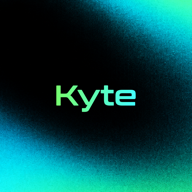

<p align="center">
  
</p>

<h1 align="center">Kyte MCP</h1>

<p align="center">
  The Kyte options market on Robinhood Chain, inside Claude, ChatGPT, Cursor, Codex and Gemini.<br/>
  Live markets and on-chain data in. Prepared trades out. Your wallet signs, never the AI.
</p>

<p align="center">
  <a href="https://kyte.sh/mcp">kyte.sh/mcp</a> ·
  <a href="https://kyte.sh">kyte.sh</a> ·
  <a href="https://hol.org/registry/agent/uaid:aid:2P6i4mmnXKNeBw4SkxwGre4AptYWs3hB5kZGBtcKocEvytjLjuxDUHLoT6PuBHw6sx">HOL registry</a> ·
  <a href="https://x.com/useKyte">@useKyte</a>
</p>

<p align="center">
  <a href="https://heyresearch.xyz/project/kyte"></a>
</p>

---

## What it is

[Kyte](https://kyte.sh) is a non-custodial, fully collateralised options market on Robinhood Chain (chain id 4663).
Sellers lock tokens for covered calls or WETH for cash-secured puts; buyers pay a premium for the right to exercise.

This MCP server connects any AI app to that market:

- **Ask** about markets, open calls and puts, prices, charts, a wallet's positions, staking, protocol stats, the
  on-chain fee and burn proof, and Pons launchpad tokens listed on Kyte.
- **Prepare** a trade: buy an offer, sell a covered call or cash-secured put, exercise, stake. The server checks the
  inputs against the protocol rules and returns a **kyte.sh link** with everything pre-filled.
- **You sign.** You open the link, check the numbers and sign in your own wallet. The server holds no keys and sends no
  transactions.

|  |  |
|---|---|
| Endpoint | `https://kyte.sh/api/mcp` |
| Transport | Streamable HTTP (stateless, JSON responses) |
| Auth | None: public market data only |
| Tools | 20 (14 read, 6 prepare) |
| Resources | 6 docs |
| Prompts | 3 |

## Connect

### Claude (claude.ai, desktop, mobile)

Settings → **Connectors** → **Add custom connector** → name `Kyte`, URL `https://kyte.sh/api/mcp` → Add → Connect.
Claude groups the read-only tools separately from the prepare tools, so you can allow reads and keep prepares on
"ask".

### Claude Code

```bash
claude mcp add --transport http --scope user kyte https://kyte.sh/api/mcp
```

Or install this repository as a plugin; `.claude-plugin/plugin.json` and `.mcp.json` point at the same server.

### ChatGPT

Settings → **Connectors** → **Create** → paste `https://kyte.sh/api/mcp` → enable it in a chat.

### Cursor

`~/.cursor/mcp.json`:

```json
{
  "mcpServers": {
    "kyte": { "url": "https://kyte.sh/api/mcp" }
  }
}
```

### Codex, Gemini CLI

Install this repository as a plugin or extension: `.codex-plugin/plugin.json` and `gemini-extension.json` are included.

## Try it

> What PONS calls are open on Kyte right now, and which is the best value?

> Which Pons launchpad tokens graduated today and are listed on Kyte?

> Explain offer 0x… for me: breakeven, max loss, max payoff.

> What does 0xYourWallet hold on Kyte, and what expires this week?

> Prepare a covered call on 10 PONS, 20% above spot, premium 0.001 ETH, 1 day.

> Set up Autopilot: flag any option I hold that is 5% in the money in its last 24 hours.

## Tools

### Read (annotated `readOnlyHint: true`)

| Tool | What it returns |
|---|---|
| `list_tokens` | Listed tokens, puts on or off, exposure cap, minimum strike; Pons tokens are marked with their 24 h expiry rule |
| `find_offers` | Open offers to buy now, by token and kind, soonest expiry first |
| `get_offer` | One offer or position in full: terms, seller, holder, status, fees, creating transaction |
| `get_positions` | What an address holds, is selling, and its recent history |
| `get_prices` | Live price in ETH per token, 1 h change and source (Uniswap v4 or Robinhood quote) |
| `get_chart` | Recent OHLC candles for a token |
| `get_staking` | $KYTE staked, epoch timing, rewards, and an address's stake and claimable WETH |
| `get_protocol_stats` | Volume, fees, open interest, $KYTE burned and staked, stakers, offers |
| `get_proof` | Every fee split and every buyback burn, each with its transaction |
| `get_activity` | Recent listings, fills, exercises, expiries, splits, burns, staking |
| `explain_offer` | Plain-language economics for both sides: breakeven, max loss, max payoff, fees |
| `compare_offers` | Open offers on one token ranked by premium, premium vs strike, strike vs spot, time left |
| `list_graduated` | Pons launchpad tokens: graduated, near graduation, or listed on Kyte, with price and links |
| `list_strategies` | An address's Autopilot rules and the prepared actions waiting for it |

### Prepare (annotated `readOnlyHint: false`, never send anything)

| Tool | What it prepares |
|---|---|
| `prepare_buy` | Buying an open offer: preview plus a link to its buy dialog |
| `prepare_covered_call` | Selling a covered call: validates token, amount, strike, premium and expiry; returns a pre-filled Sell link |
| `prepare_cash_secured_put` | Selling a cash-secured put on tokens with puts enabled |
| `prepare_exercise` | Exercising a held option: what you pay and receive, including the fee |
| `prepare_stake` | Staking, unstaking or claiming WETH rewards |
| `design_strategy` | An Autopilot rule from plain language, with a 30-day look back and a link to sign it |

Every prepare tool returns a preview and a `https://kyte.sh/...` link. Nothing happens until the user opens it and
signs in their wallet.

## Prompts and resources

| Prompts | Resources |
|---|---|
| `find_best_offers` (token) | `kyte://docs/how-it-works` |
| `explain_my_positions` (address) | `kyte://docs/fees` |
| `protocol_health` | `kyte://docs/staking`, `kyte://docs/rules` |
|  | `kyte://docs/risks`, `kyte://docs/glossary` |

The resources are the official docs, so a client grounds its answers in the real rules.

## Autopilot

Rules you sign once (a free message signature on [kyte.sh/autopilot](https://kyte.sh/autopilot)): sell covered calls
or puts on a schedule, flag offers to buy that match your filters, exercise in the money before expiry, cancel stale
offers. Kyte watches the market every minute and, when a rule's condition holds, prepares the exact transaction for
you to review and sign. No funds or keys are ever held. Ask your AI to design a rule with `design_strategy`, and to
show what is waiting with `list_strategies`.

## Pons launchpad tokens

Tokens that graduate on [Pons](https://ponsfamily.com) (4.2 ETH of locked liquidity, WETH pair, liquidity in the Pons
locker) are listed on Kyte automatically. Options on them expire within **24 hours**; the prepare tools enforce it.

## Security

- **Non-custodial by design.** No tool can sign, send, spend, or read a key.
- **Every number comes from the chain** through the Kyte indexer, the same API kyte.sh uses.
- **Data is not instructions.** Token names and on-chain text are treated as untrusted data.
- **Rate limited** per client.
- **Runs well under [HOL Guard](https://hol.org/guard):** allow the read tools, keep the prepare tools on review.
- Scanned on every push with the [HOL AI Plugin Scanner](https://github.com/hashgraph-online/ai-plugin-scanner-action).

Report a vulnerability: see [SECURITY.md](SECURITY.md).

## Listings

- HOL registry: [Kyte Options Market](https://hol.org/registry/agent/uaid:aid:2P6i4mmnXKNeBw4SkxwGre4AptYWs3hB5kZGBtcKocEvytjLjuxDUHLoT6PuBHw6sx)
  (`uaid:aid:2P6i4mmnXKNeBw4SkxwGre4AptYWs3hB5kZGBtcKocEvytjLjuxDUHLoT6PuBHw6sx`)
- HOL plugins: `usekyte-org/kyte-mcp`

## Disclaimer

Options are risky and can expire worthless. Kyte's tools provide information, not financial advice. Kyte is not
affiliated with or endorsed by Robinhood.

## Contracts (Robinhood Chain, chain id 4663)

| | |
|---|---|
| KYTE token | `0x072D88c2F31F568C0F4B8F613692eB489541Ed45` |
| CallMarket v3 | `0xb6759D8893601BB7c1A032eC8ea40C856a6adf80` |
| PutMarket v3 | `0x2E2d5DfB4cf30d15688Cc2DDD30641c78DFfcb35` |
| Router v3 | `0xdD76956667E6423bAC56d2EbF827a9b0d7dBDF68` |
| StakingPool | `0xD7253a90fd43507F44cF0934F3D5d7432760d17f` |

Full list and older market sets: https://kyte.sh/docs#contracts

## License

MIT
